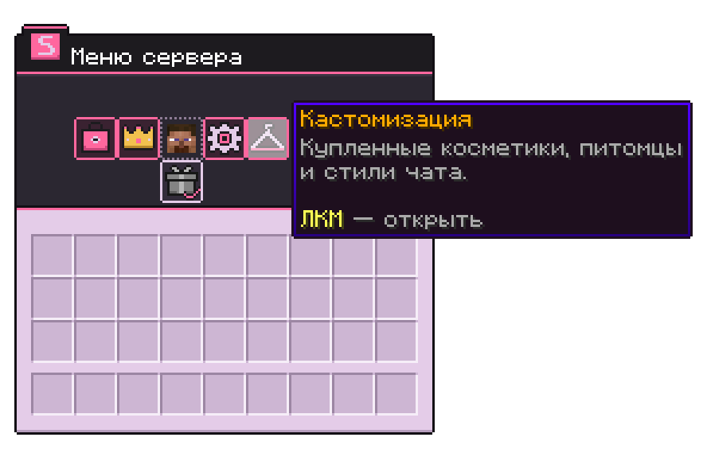
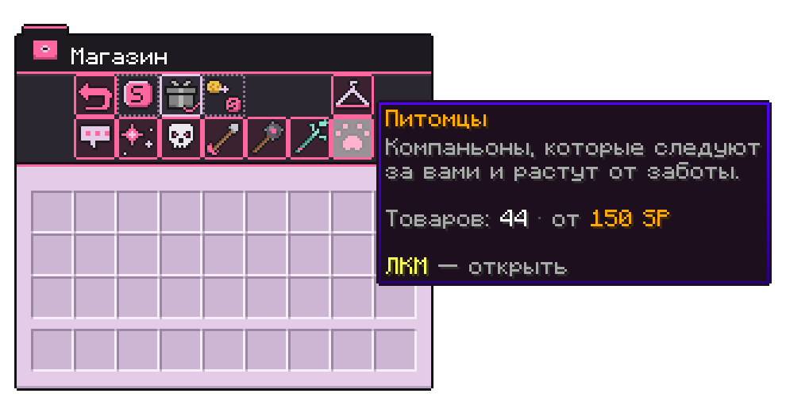
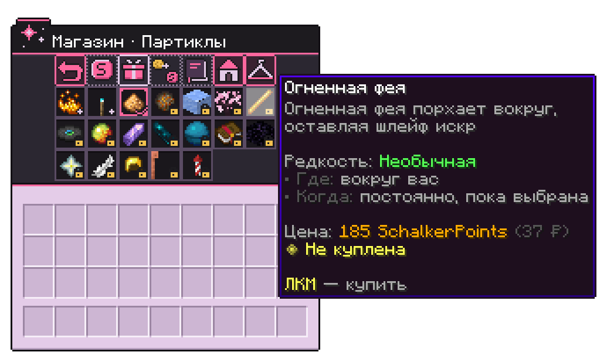
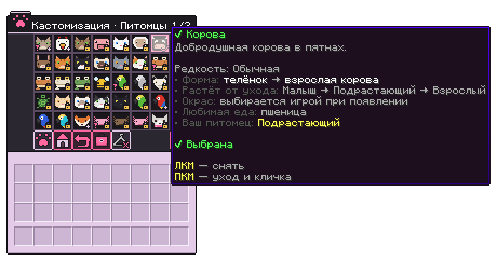
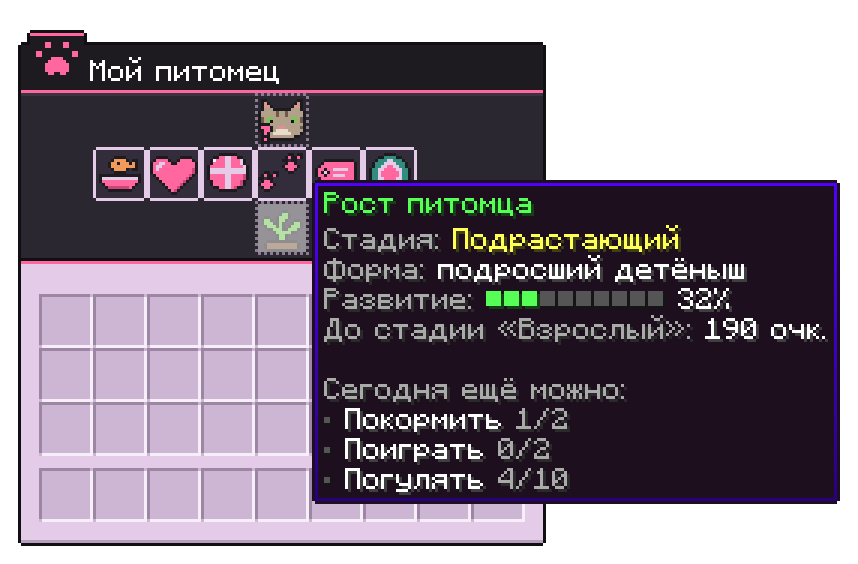

Косметика меняет только внешний вид: частицы вокруг персонажа, питомцы, анимации смерти и эффекты оружия. На бой и добычу она не влияет.

## Как купить

1. Введите <code>/menu</code> и откройте **Магазин**.
2. Выберите категорию и наведите на предмет. В описании указаны редкость, цена и что делает эффект.
3. Нажмите <kbd>ЛКМ</kbd>, чтобы купить. Нажмите ещё раз, чтобы надеть.

Покупка остаётся у вас навсегда. Редкость написана в описании предмета цветом: серый у обычной, зелёный у необычной, голубой у редкой, фиолетовый у эпической и золотой у легендарной.

С подпиской **Schalker** вся косметика открыта без покупки. Подписку можно [купить на сайте](https://schalker.net/shop/schalker-1m) или за SchalkerPoints в <code>/menu</code> → **Подписки**.

## Где взять SchalkerPoints

- **Купить на сайте**: [schalker.net/shop/schalker-points](https://schalker.net/shop/schalker-points). За 1 ₽ вы получаете 5 SchalkerPoints, они приходят на ник сразу после оплаты.
- **Голосовать за сервер** на HotMC: 15 SchalkerPoints за голос. Ссылка и награда лежат в <code>/menu</code> → **Магазин** → **Голос за сервер**.
- **Ежедневный бонус**: тортик в любой категории магазина, раз в сутки. Подписчики получают больше.

## Как надеть и снять

Купленное лежит в <code>/menu</code> → **Кастомизация**. В каждой категории можно надеть один предмет: например, одни частицы и одного питомца одновременно. Клик по надетому предмету снимает его.

## Категории

| Категория | Когда видно | Предметов | Цена, SP |
|---|---|---|---|
| Партиклы | Всегда, пока надеты | 19 | 90–470 |
| Эффекты смерти | При вашей смерти и убийстве игрока | 29 | 100–480 |
| Эффекты стрел | Выстрел из лука или арбалета | 21 | 60–380 |
| Эффекты булавы | Удар булавой с падения | 31 | 85–430 |
| Бросок трезубца | Полёт брошенного трезубца | 16 | 90–380 |
| Тягун | Рывок трезубцем с «Тягуном» | 15 | 80–275 |
| Питомцы | Ходят за вами | 44 | 150–380 |

Стили чата тоже продаются в магазине, про них отдельная страница: [Стили чата](/wiki/chatstyles).

### Партиклы

Частицы вокруг персонажа: крылья, нимбы, ауры, следы за шагами.

- **Обычные:** Аура критов, След душ, Сияющий нимб
- **Необычные:** Огненная спираль, Морозный круг, Огненная фея, Цветение сакуры
- **Редкие:** Магический щит, Адский смерч, Атомные орбиты, Энергетические импульсы, Мелодия
- **Эпические:** Крылья ангела, Чёрная дыра, Звездопад, Магический круг
- **Легендарные:** Радужные крылья, Золотая корона, Грозовая туча

### Эффекты смерти

Анимация на месте вашей смерти. Она же проигрывается, когда вы убиваете другого игрока.

- **Обычные:** Исчезновение в дыму, Праздник конфетти, Брызги крови
- **Необычные:** Всплеск душ, Вспышка инферно, Спираль духа, Тайная спираль, Фонтан океана, Прощание с любовью
- **Редкие:** Рука из могилы, Тайная сфера, Расколотое ядро, Взрыв сверхновой, Небесный столп, Призматический раскол, Солнечная вспышка, Снежная буря
- **Эпические:** Ледяной финал, Вихрь пустоты, Реквием тотема, Чёрная дыра, Громовой суд, Восхождение призрака, Последний цветок, Прах к праху, Окаменение
- **Легендарные:** Удар молнии, Метеорит, Возрождение феникса

### Эффекты стрел

Шлейф за стрелой из лука или арбалета и вспышка в месте попадания.

- **Обычные:** Искра, Яд, Пепел, Муссон
- **Необычные:** Пламя душ, Тайная стрела, Ледяной луч, Фантом, Токсичное облако, Фея
- **Редкие:** Небесные кольца, Солнечная вспышка, Туманность, Кристальное копьё, Звёздный свет, Изумрудный змей
- **Эпические:** Бездна, Грозовой разряд, Пламя преисподней, Кольца пустоты
- **Легендарные:** Призматический луч

### Эффекты булавы

Анимация удара, когда вы бьёте булавой в падении.

- **Обычные:** Пылевое кольцо, Тройной разрез
- **Необычные:** Ударная волна, Морозный раскол, Инферно, Звуковой удар, Разлом земли, Кольцо лепестков, Водяной столб, Буря углей
- **Редкие:** Электрошторм, Пустота, Вихрь, Звездопад, Призматические копья, Рунная матрица, Обсидиановые слёзы, Цунами, Светящаяся сетка
- **Эпические:** Громовая клетка, Извержение, Ледниковая тюрьма, Разрыв бездны, Звуковой кратер, Гравитационный колодец, Пространственный разрыв, Вспышка зенита, Кристальные шипы
- **Легендарные:** Цепная молния, Колокольный звон, Призрачные цепи

### Трезубец и Тягун

В магазине это одна категория, но надеваются эффекты отдельно: на бросок трезубца и на рывок с зачарованием «Тягун».

Бросок:

- **Обычные:** Цветение, Шквал
- **Необычные:** Прилив, Орбита, Звуковой импульс, Пекло, Расцвет
- **Редкие:** Буря, Бездна, Цунами, Сияние, Кристалл
- **Эпические:** Копьё пустоты, Водоворот, Кракен
- **Легендарные:** Повелитель молний

Тягун:

- **Обычные:** Пузыри, Сакура, Розовый ветер
- **Необычные:** Ненастье, Свечение, Ледяной поток, След душ
- **Редкие:** Космос, Рассвет, Чернила, Звёздный путь
- **Эпические:** Грозовая линия, Поток пустоты, Водоворот, Огненный рывок

## Питомцы

Питомец ходит за вами, а если отстанет, сам появится рядом. Ударить его нельзя.

В магазине есть кошки (12 окрасов), попугаи (6), аксолотли (5), лягушки (4), а ещё лиса, волк, пчела, тихоня, мини-голем, верблюд, лавомерка, панда, коза, лама, черепаха, свинья, корова, овца, курица и кролик. Самый редкий питомец, легендарный, это нюхач.

### Уход и рост

Купленный питомец появляется малышом и растёт от вашего ухода: **Малыш** → **Подрастающий** → **Взрослый**. Кошка, лиса, волк и другие мобы с детской формой начинают детёнышем и к последней стадии вырастают во взрослого моба. Тихоня, попугай, голем и лягушка выглядят одинаково на всех стадиях.

Что даёт развитие:

- **Покормить** едой из инвентаря. У каждого вида есть любимое лакомство, за него очков больше.
- **Погладить**.
- **Поиграть**: питомец попрыгает от радости.
- **Гулять** пешком вместе с питомцем.

У каждого действия есть дневной лимит, он сбрасывается в полночь по Москве. Первое действие за день приносит бонус. Чужого питомца тоже можно погладить, это немного помогает ему расти.

Если хотите оставить питомца маленьким, отключите рост в его меню.

### Управление

- <kbd>ПКМ</kbd> по питомцу: погладить.
- <kbd>Shift</kbd> + <kbd>ПКМ</kbd> по питомцу: меню питомца. Его же открывают команда <code>/cosmetics pet</code> и <kbd>ПКМ</kbd> по надетому питомцу в **Кастомизации**.
- Кличку задают в меню или переименованной биркой (<kbd>ПКМ</kbd> по своему питомцу).
- Попугая можно посадить на плечо через меню.
- **Позвать к себе** в меню переносит питомца к вам, **Убрать питомца** прячет его. Прогресс и кличка при этом сохраняются.

