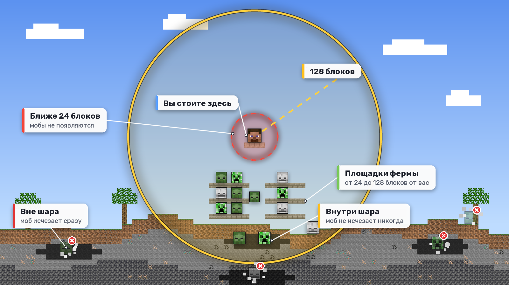
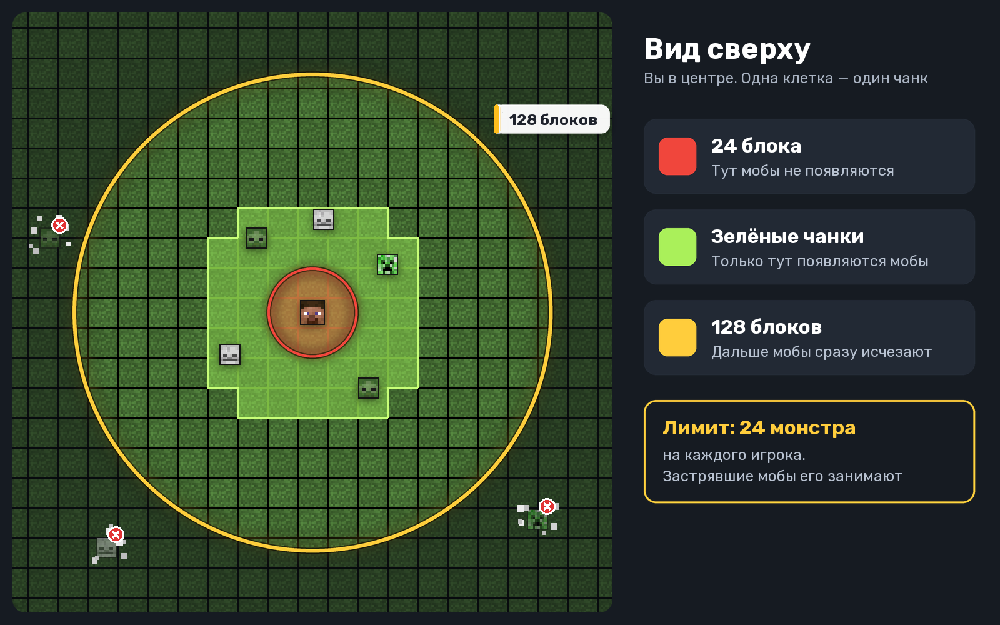

Механики на сервере ванильные, но лимиты другие. Прочитайте это перед тем, как строить ферму.

## Коротко

| | У нас | В обычном Minecraft |
|---|---|---|
| Лимит монстров | **24** на игрока | 70 |
| Где появляются мобы | **~4 чанка** от вас | 8 чанков |
| Когда моб исчезает | **только дальше 128 блоков** | дальше 32 блоков, со временем |

> Ферма с YouTube у нас будет работать медленнее, чем на видео.

## Шар 128 блоков

- **Вне шара** моб исчезает сразу.
- **Внутри шара** моб не исчезает никогда и занимает место в лимите.
- Шар считается от **ближайшего** игрока.

Зомби в тёмной пещере в 100 блоках от вас будет стоять там вечно. Если таких наберётся 24, ферма остановится.

## Где появляются мобы

- Только в **~4 чанках** вокруг вас (зелёные чанки на схеме).
- Не ближе **24 блоков** к вам.

## Как построить мобоферму

1. Площадки фермы ставьте **в 24–48 блоках** от AFK-точки.
2. Поднимите AFK-точку **выше 128 блоков над землёй**. Тогда пещеры окажутся вне шара.
3. Если ферма ниже, **освещайте всё в 8 чанках вокруг**.
4. Мобы должны **сразу уходить с площадок**: водой или падением.

## Полезно знать

- Монстры дальше **48 блоков** засыпают, если стоят на месте. Падающих и плывущих в воде это не касается.
- Вдвоём на одной ферме рейты **не удваиваются**.
- Мобы из спавнеров, с биркой и разведённые животные в лимит не идут.
- Рыбы, кальмары, светящиеся кальмары и летучие мыши появляются очень редко. Фермы на них почти не работают.
- Куры дальше 32 блоков от вас почти не несут яйца.
- В одном чанке сохраняется **не больше 8 эндер-жемчужин**. Лишние пропадают, когда чанк выгружается. Учтите это в стазис-камерах.
- Предметы на земле лежат **8 минут**.
- Патрулей разбойников нет, рейды работают.
- Редстоун ванильный. Дюп ТНТ, ковров и рельсов работает.
