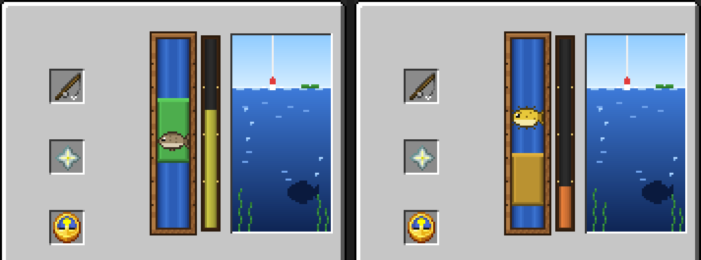
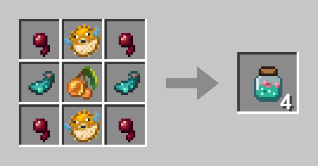
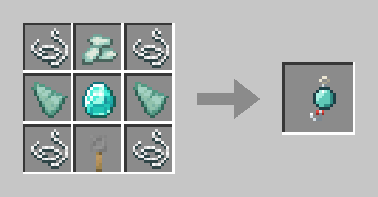
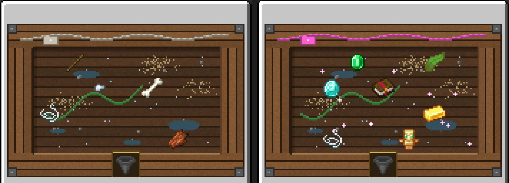

Рыбачить можно обычной удочкой. На каждой поклёвке открывается мини-игра: вытащили рыбу, получили улов и шанс на рыболовный мешочек.

## Мини-игра

1. Забросьте удочку и дождитесь надписи **«Клюёт! Подсекайте»**.
2. Подсеките (<kbd>ПКМ</kbd>), откроется окно мини-игры.
3. Кликайте по окну, чтобы поднимать зелёную зону. Если не кликать, зона падает.
4. Держите рыбу внутри зоны, пока не заполнится шкала прогресса.

Когда рыба выходит из зоны, прогресс убывает. Рыба сорвётся, если шкала опустеет или вы провозитесь дольше минуты. Улов пропадёт, если закрыть окно, погибнуть или телепортироваться.

### Сложность

Сложность видно в заголовке окна и по значку рыбы. Чем она выше, тем меньше зелёная зона и шустрее рыба.

| Сложность | Что на крючке |
|---|---|
| Лёгкая | Треска и мусор |
| Обычная | Лосось и прочий улов |
| Сложная | Тропическая рыба и иглобрюх |
| Экстремальная | Сокровища: зачарованные книги, удочки и луки, раковина наутилуса, бирка, седло |

За сложную рыбу мешочек выпадает чаще, чем за треску.

### Качество улова

| Качество | Как получить |
|---|---|
| Идеальный | Рыба не уходила из зоны. Короткие касания края не считаются |
| Хороший | Рыба провела в зоне почти всё время |
| Обычный | Всё остальное |

Качество не меняет сам улов, зато повышает шанс мешочка. После победы чат покажет, какой шанс у вас получился.

## Рыбные места

Пока вы рыбачите, на воде неподалёку иногда появляется водоворот, и в чат приходит сообщение **«Рядом появилось рыбное место»**. Закиньте поплавок в круг: за улов оттуда мешочек выпадает заметно чаще.

Место выдерживает несколько уловов и иссякает. Нетронутый водоворот пропадает сам через несколько минут. Если на одном пруду рыбачит толпа, мест там появляется столько же, сколько для одного рыбака.

## Снаряжение удочки

Возьмите удочку в основную руку и нажмите <kbd>F</kbd>, откроется меню снаряжения. Руки меняются через <kbd>Shift</kbd> + <kbd>F</kbd>.

В меню два слота: наживка и снасть. Снаряжение хранится в самой удочке, его запас видно в описании удочки.

### Наживка

С наживкой лёгкий улов часто заменяется рыбой посложнее: лососем, иглобрюхом или тропической рыбой, а за неё мешочки падают чаще. Одна наживка тратится на одну подсечку.

### Снасть

Снасть расширяет зелёную зону, и рыбу проще удержать. Каждая мини-игра изнашивает снасть, даже проигранная. Остаток прочности указан в описании снасти.

## Рыболовные мешочки

Мешочек выпадает в дополнение к улову, рыбу вы получаете в любом случае. Внутри лежит сразу несколько предметов.

| Мешочек | Что внутри |
|---|---|
|  **Обычный** | В основном мусор и простые ресурсы |
|  **Необычный** | Ресурсы, слитки, изредка ценности |
|  **Редкий** | Слитки, изумруды, алмазы, хорошие книги. Может попасться «Починка» |
|  **Эпический** | Алмазы, сильные книги, первые сокровища |
|  **Легендарный** | Тотемы, сердце моря, незеритовый лом, лучшие книги |
|  **Мифический** | Незерит, зачарованные золотые яблоки, яйцо нюхача. «Починка» внутри всегда |

Чем выше редкость, тем реже выпадает мешочек и тем больше в нём предметов. Качество улова и рыбные места решают только, выпадет ли мешочек. Редкость каждый раз случайная. Где ещё искать «Починку», написано на странице [Добыча починки](/wiki/mending).

### Открытие

Возьмите мешочек в руку и нажмите <kbd>ПКМ</kbd>. Возле сундука или двери зажмите <kbd>Shift</kbd>.

Находки по одной появляются на дне ящика. Самые ценные выпадают последними с пометкой **Редкая находка** или **Сокровище**. Забирайте их кликом или кнопкой **«Забрать всё»**. Если закрыть ящик раньше, остаток переложится в инвентарь.
