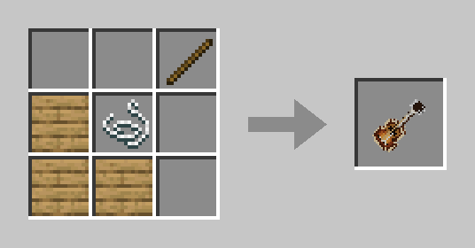

Гитару слышат все игроки рядом. На ней можно играть по нотам, бить аккорды, запустить автоматический перебор или включить готовую мелодию.

## Крафт

Подойдут доски любого дерева.

## Управление

Возьмите гитару в руку. Над хотбаром появится подсказка с выбранной нотой или аккордом.

- <kbd>ПКМ</kbd> / <kbd>ЛКМ</kbd> играют.
- Взгляд вверх-вниз выбирает ноту или аккорд: вверх выше, вниз ниже.
- <kbd>F</kbd> переключает режим.
- <kbd>Shift</kbd> + <kbd>ПКМ</kbd> открывает настройки.
- <kbd>Shift</kbd> + <kbd>F</kbd> записывает луп.

По сундукам, дверям и другим блокам с меню <kbd>ПКМ</kbd> работает как обычно и открывает их.

## Режимы

| Режим | Как играть |
|---|---|
| Соло | <kbd>ПКМ</kbd> или <kbd>ЛКМ</kbd> играют одну ноту. Зажатая <kbd>ПКМ</kbd> даёт тремоло |
| Аккорды | <kbd>ПКМ</kbd> бьёт вниз, <kbd>ЛКМ</kbd> вверх, <kbd>Shift</kbd> + <kbd>ЛКМ</kbd> глушит струны |
| Авто | <kbd>ПКМ</kbd> запускает и останавливает перебор или бой, аккорд меняется взглядом |
| Треки | <kbd>ПКМ</kbd> играет и останавливает мелодию, <kbd>ЛКМ</kbd> включает следующую, <kbd>Shift</kbd> + <kbd>ЛКМ</kbd> предыдущую |

Поверх трека можно подыгрывать: включите трек и переключитесь в другой режим.

## Настройки

В меню (<kbd>Shift</kbd> + <kbd>ПКМ</kbd>) настраиваются:

- **Громкость.** Чем громче, тем дальше вас слышно.
- **Взгляд.** Можно поменять местами: вниз выше нота, вверх ниже.
- **Тональность, лад и октава** для соло. Если не знаете, что выбрать, оставьте пентатонику: с ней почти любая мелодия звучит складно.
- **Ритм и темп** для режима «Авто»: перебор «восьмёрка», перебор «вальс», бой «шестёрка», бой с глушением и ровный бой.
- **Набор аккордов.** До 7 аккордов: первый звучит, когда смотрите вниз, последний, когда вверх. Есть готовые наборы: «Поп», «Дворовый», «Рок», «Блюз» и «Лирика».
- **Список треков.**

### Треки

Гитара знает 10 мелодий: «Коробейники», «Испанский романс», «Ода к радости», «К Элизе», «Канон ре мажор», «Зелёные рукава», «Менуэт соль мажор», «С днём рождения», «В лесу родилась ёлочка» и «Бубенцы». Включить трек можно в режиме «Треки» или кликом по нему в списке.

## Луп

Луп повторяет сыгранную фразу по кругу, а вы играете поверх неё.

1. Нажмите <kbd>Shift</kbd> + <kbd>F</kbd>. Запись начнётся с первой ноты.
2. Сыграйте фразу длиной до 30 секунд.
3. Нажмите <kbd>Shift</kbd> + <kbd>F</kbd> ещё раз. Луп заиграет сразу.

Дальше <kbd>Shift</kbd> + <kbd>F</kbd> останавливает и снова запускает записанный луп. Чтобы записать новый или удалить старый, откройте настройки. Если убрать гитару из руки во время записи, запись отменится.
