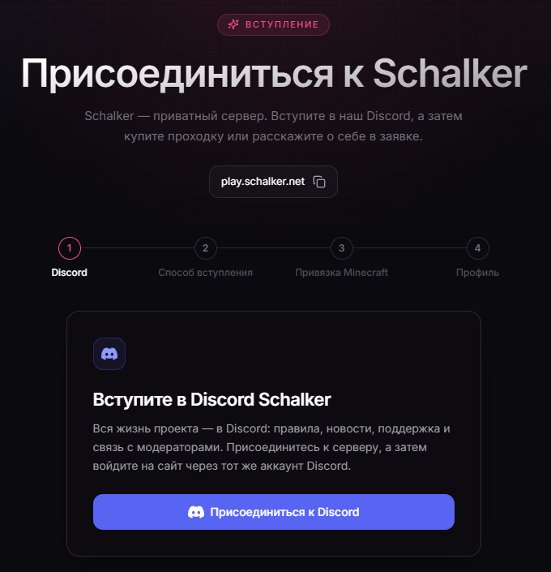
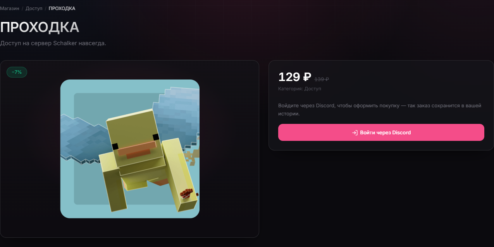
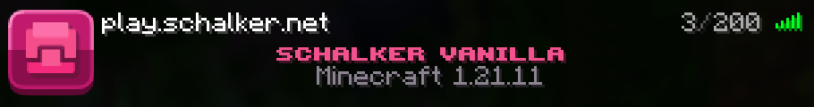
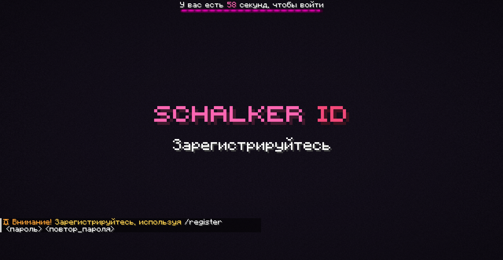
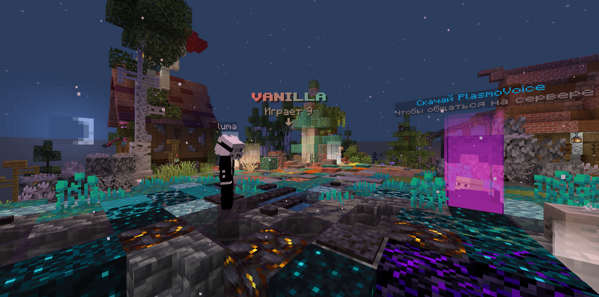
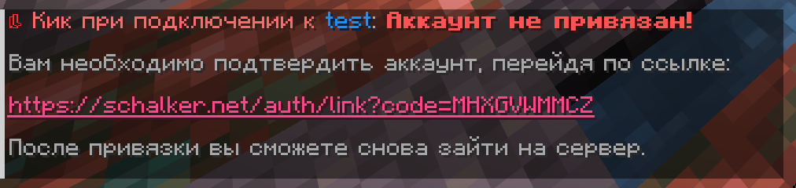
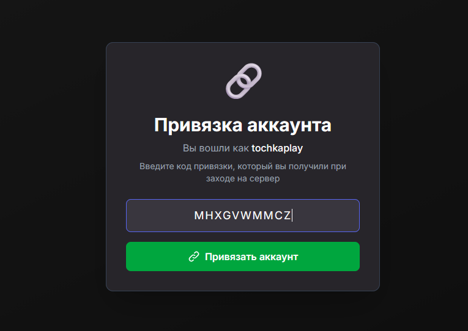

### Как начать играть на проекте Schalker Vanilla?

Schalker — это приватный ванильный сервер, созданный для ламповой и сплочённой игры. На сервере нет привата территорий, лишних плагинов и привилегий. Зайти можно как с пиратской, так и с лицензионной версии игры.

Перед началом обязательно прочитайте Правила и Информацию в нашем [Discord сервере](https://discord.gg/schalker).

### Первое — Discord и вход на сайт

Вступление теперь проходит на сайте, на странице [Присоединиться](https://schalker.net/join).

1. Нажмите «Присоединиться к Discord» и вступите в наш Discord сервер
2. Войдите на сайт через тот же аккаунт Discord

### Второе — проходка или заявка

После входа сайт предложит два способа попасть на сервер.

**Купить проходку** — самый быстрый вариант. Доступ на сервер выдаётся навсегда сразу после оплаты, ждать модерацию не нужно. Проходка продаётся в [магазине](https://schalker.net/shop/access). При покупке укажите ник, с которого будете играть: доступ получит именно он.

**Подать заявку** — бесплатно, но её проверяют модераторы. В заявке нужно:

1. Указать ник Minecraft Java Edition, с которого будете играть
2. Ответить на несколько вопросов о себе
3. Подтвердить, что прочитали правила
4. Прикрепить скриншоты подписки на наши соцсети, если сайт их попросит
5. Проверить ответы и отправить заявку

Черновик сохраняется сам, заполнить заявку можно не за один раз. Отправить её получится, только если вы состоите в нашем Discord сервере.

Статус заявки придёт на сайт и в Discord. Если модератор попросит что-то исправить, поправьте ответы и отправьте заявку снова.

Бывает, что проходка временно бесплатная — тогда на сайте будет об этом отметка, и достаточно просто заполнить заявку.

### Третье — как зайти?

1. Подключитесь к серверу `play.schalker.net` на версии, указанной на главной странице сайта

2. Зарегистрируйтесь или войдите в аккаунт

### Команды авторизации

<table>
    <thead>
    <tr>
        <th>Команда</th>
        <th>Назначение</th>
    </tr>
    </thead>
    <tbody>
    <tr>
        <td><code>/register</code></td>
        <td>Регистрация аккаунта</td>
    </tr>
    <tr>
        <td><code>/login</code></td>
        <td>Вход в аккаунт</td>
    </tr>
    </tbody>
</table>

3. Вас перекинет в лобби нашего сервера
4. Прыгайте в портал, над которым надпись Schalker Vanilla

### Четвёртое — привязка аккаунта

Последний шаг — привязать Minecraft-аккаунт к сайту. Пока аккаунт не привязан, сервер покажет ссылку с кодом привязки.

1. Перейдите по ссылке из сообщения или откройте [страницу привязки](https://schalker.net/auth/link) и введите код вручную
2. Нажмите «Привязать аккаунт»

После привязки появится ваш игровой профиль и откроется весь сайт. Можно заходить на сервер.

### Приятной игры!
